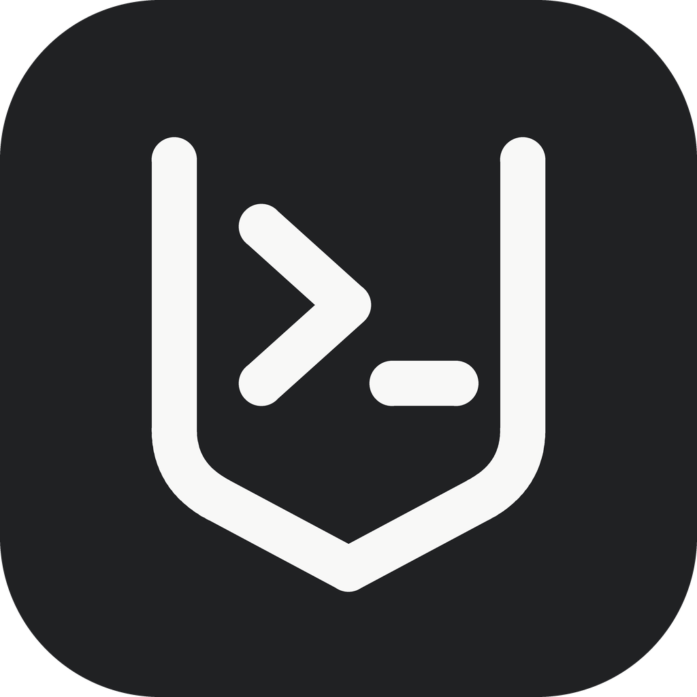
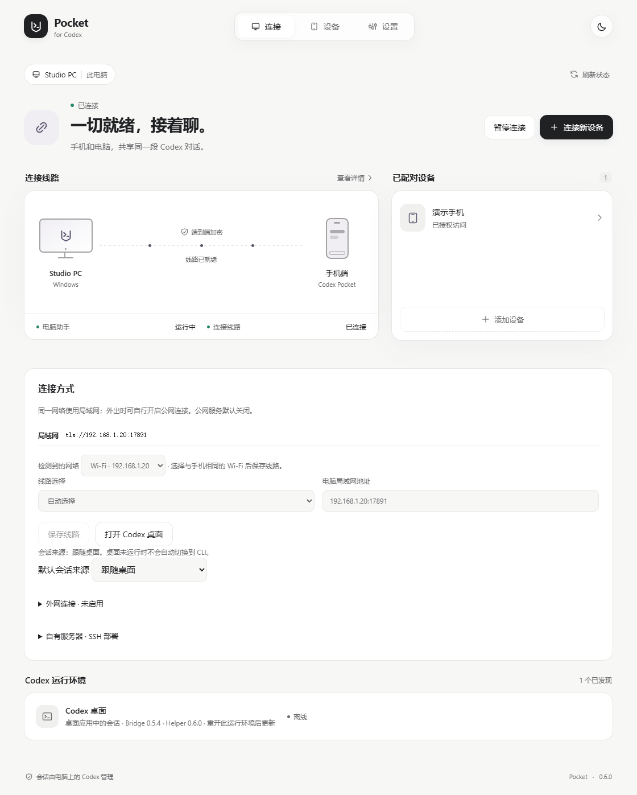
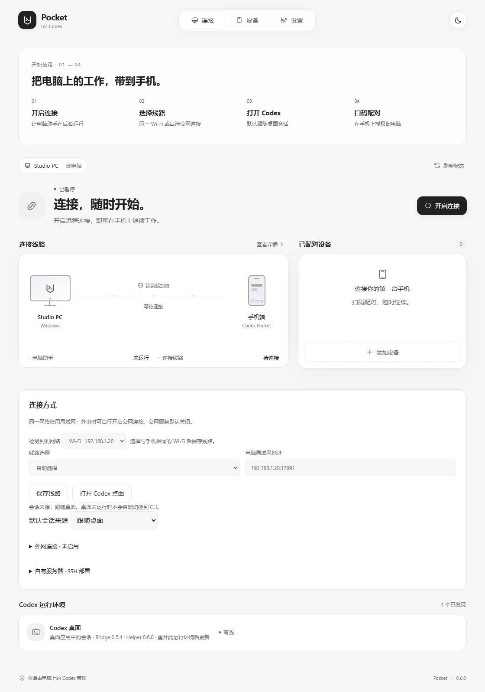
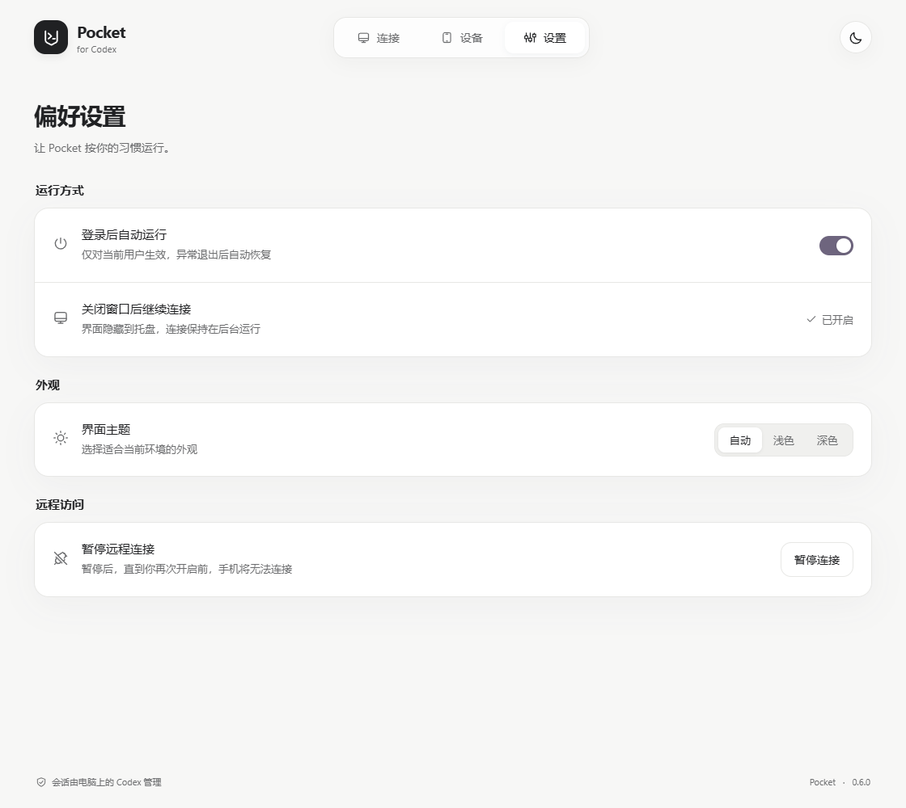
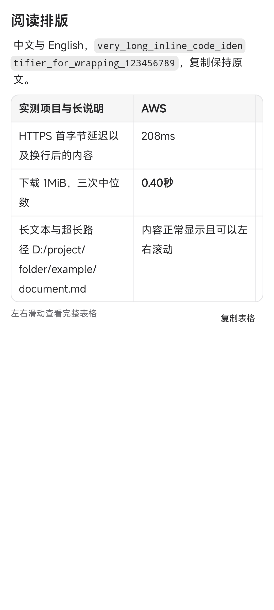
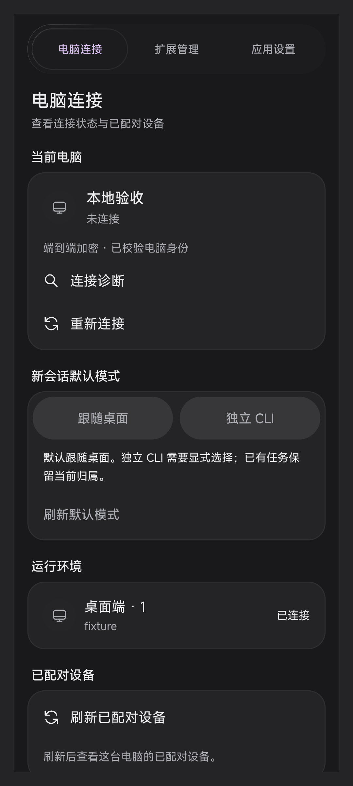

# Codex Pocket

**用 Android 手机接着做电脑上的 Codex 任务。** 看进度、发补充、处理审批、查看代码更改；项目和模型凭据留在你的 Windows 电脑上。

这是社区项目，与 OpenAI 官方产品没有隶属关系。电脑需要开机并联网。

## 下载

在 [Releases](https://github.com/znjhahaha/Codex-Pocket/releases) 下载同一版本的：

- **Windows Setup.exe**：新用户选它，双击安装。
- **Android APK**：安装到手机；升级直接覆盖，保留配对和草稿。
- Windows ZIP 是便携交付，源码和 SHA-256 清单也随版本提供。

当前开发版本为 **0.6.0 / Android versionCode 10**。0.6 的发布流程先生成草稿，正式发布前请以 Releases 中已公开的版本为准。Windows 安装器暂未签署 Authenticode，系统可能显示未知发布者。

## 三步连接

1. **电脑安装。** 先准备可正常使用的 Codex 桌面端，再运行 Pocket 的 Setup.exe。安装后从开始菜单打开 **Codex Pocket**。
2. **选连接方式。** 同一 Wi-Fi 选局域网；需要在外使用时可启动临时 Cloudflare 隧道，或配置固定域名／自己的中转服务器。点击“开启连接”。
3. **手机扫码。** 在电脑点“连接新设备”，手机扫描二维码并确认电脑名称，然后选择项目开始使用。

默认“跟随桌面”：桌面未运行时由 Pocket 启动。日常从快捷方式或托盘打开即可，不需要输入命令。如果已有 Codex 正在运行，首次接入或升级后需等任务结束，再正常退出并打开 Codex，让新桥接生效。

**从旧版本升级：** 覆盖安装后，如果后台仍显示旧版本，等当前任务结束再重启一次 Windows；打开开始菜单中的 **Codex Pocket**，点击“开启连接”，再用 **Codex Pocket Desktop** 打开 Codex。后者会明确使用当前安装的桥接。不要直接双击 `pocket-bridge.exe`，它由桌面自动调用。

助手、桥接和托盘都在同一个安装包中。它们分进程运行，因此安装文件更新后，已打开的进程可能仍是旧版；连接页会分别显示安装版本与运行版本，无需分别输入启动命令。

以上是 0.6 真实前端的本地主机渲染截图，使用演示设备数据；不代表公网或手机端已验收。配对演示见 [扫码窗口](docs/images/v06-pairing-fixture.png)，其中二维码不可用于配对。

## 电脑和手机怎么接手

默认通过 Codex 桌面的桥接读写同一个原生会话，手机不会因为重新连接就把桌面会话转给 CLI。

需要独立运行时，可明确选择 **独立 CLI**。已有 CLI 会话可选择 **交还桌面**：正在执行时先等待结束；空闲后 Pocket 释放自己的订阅，核对占用解除，再让桌面接入。其他 CLI 程序仍占用时会说明原因，不会杀进程或悄悄创建分支。

全局默认方式只影响后续选择，不会迁移正在运行的会话。发送结果未知时先核对历史，不自动重发。

## 连接方式怎么选

| 方式 | 适合什么情况 | 需要什么 |
| --- | --- | --- |
| 局域网 | 手机和电脑在同一网络 | 私有网络允许 Pocket 的专用端口 |
| 临时 Cloudflare 隧道 | 临时外出使用，不想准备服务器 | 电脑能连接 Cloudflare；重启后地址可能变化 |
| 固定域名隧道 | 希望长期使用固定地址 | Cloudflare 账户、域名、受限 API Token |
| 自建中转 | 已有服务器，希望自己管理 | Ubuntu／Debian、SSH、域名及可用的 80／443 端口 |

自动模式优先局域网，公网作为回退。换线先验证同一电脑的证书与授权，再恢复消息游标；不会重发未确认的写操作。已配对的旧版本可继续使用原中转。

固定隧道由电脑保存加密的授权信息；自建中转可在设置内检查 SSH 指纹、部署、升级或回滚。它们都不会替你购买服务器。临时地址失效且没有其他可达路线时，需要重新扫码。

## 手机上可以做什么

- 按项目查看会话，搜索、置顶、重命名、归档，保留草稿。
- 阅读 Markdown、图片、工具过程、子代理和文件差异；成功任务突出最终回答。
- 续聊、停止、队列、Steer、审批、问题作答；具体操作受原生运行时能力限制。
- 选择模型与思考强度；Plan、Fast 仅在当前模型和运行时支持时开放。
- 查看上下文与额度、工作区文件，管理电脑已有 MCP、Skills 和应用配置。
- 编辑可定位的用户回合。撤回会话记录**不会撤销已经发生的文件修改**。

 

手机截图来自 MuMu 中实际运行的 0.6.0，使用本地验收数据展示排版与管理布局。

## 常见问题

**关掉窗口是不是就断开了？** 关闭窗口保留托盘。暂停连接会停止 Pocket 远控；与退出界面是不同操作。开启登录自启动后会启动后台和托盘，默认不弹窗口。

**为什么装了新版本，手机仍提示功能不可用？** 查看“已安装版本”和“运行桥接版本”。已有 Codex 进程可能仍载着旧桥接，等当前任务结束后重新打开。不要把复制文件当成已完成运行升级。

**Fast 点不了？** 需要原生设置接口、所选模型公开支持的速度档位和允许修改的会话状态。未声明支持时会说明原因。

**旧会话图片打不开？** 0.6 优先从原生历史中的内嵌图片恢复，临时文件只是兼容来源。如果原生历史也没有原图，会明确提示丢失。

**电脑显示在线，为什么某个会话不能发送？** 连接、原生运行时和会话占用分别判断。先查看该会话的占用或错误提示，不必反复重新配对。

**需要开放什么权限？** 使用你电脑现有的 Codex 权限。手机不接收 API 密钥；中转转发加密字节。二维码包含授权信息，不要公开或发给别人。

## 开发、部署与验证范围

- [Windows 使用说明](docs/windows-user-guide.md)
- [构建与开发](docs/DEVELOPMENT.md) · [手动部署中转](deploy/README.md)
- [CI 与发布流程](docs/V06-RELEASE.md) · [0.6 验收记录](docs/V06-ACCEPTANCE.md)
- [项目状态](docs/STATUS.md) · [第三方授权](THIRD_PARTY_NOTICES.md)

MuMu 已覆盖安装 0.6.0：已有会话数据切换 20 次与 120 秒停留期间连接中断 0 次；另完成真实界面 20 次进入／返回、50 次本地导航回归和 30 个带录屏阅读阶段。没有新增真实模型请求。长列表性能仍待优化；新版 Windows 桥接、真实 Windows 登录、Cloudflare／SSH 公网集成、Mate 70 Pro、HMS 与 24 小时稳定性单独记录，详细范围见验收记录。
