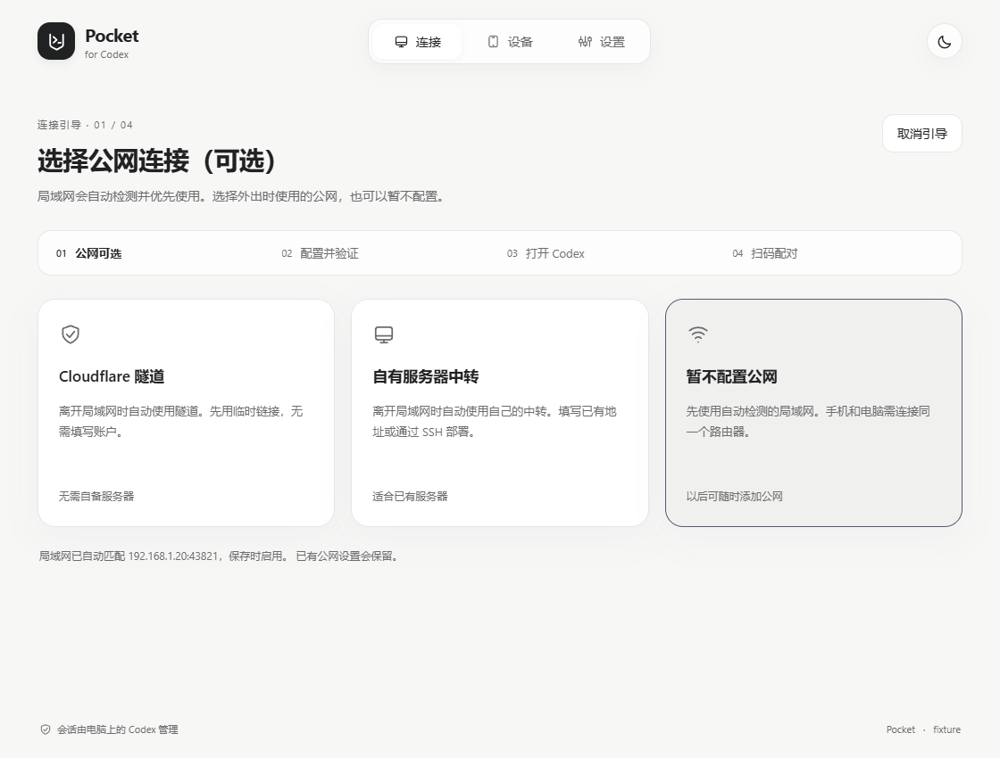

# Codex Pocket

**用 Android 手机接着做电脑上的 Codex 任务。** 看进度、发补充、处理审批、查看代码更改；项目和模型凭据留在你的 Windows 电脑上。

这是社区项目，与 OpenAI 官方产品没有隶属关系。电脑需要开机并联网。

## 下载

在 [Releases](https://github.com/znjhahaha/Codex-Pocket/releases) 下载同一版本的：

- **Windows Setup.exe**：新用户选它，双击安装。
- **Android APK**：安装到手机；升级直接覆盖，保留配对和草稿。
- Windows ZIP 是便携交付，源码和 SHA-256 清单也随版本提供。

当前开发版本为 **0.6.3 / Android versionCode 13**。发布流程先生成草稿，正式发布前请以 Releases 中已公开的版本为准。Windows 安装器暂未签署 Authenticode，系统可能显示未知发布者。

2026-11-11 开发检查点加入会话深度链接，修复冷启动首发与手机新建空会话读取，并继续接入个人助理、用量统计、P2P 和升级交接。此次为候选交付，具体实现、测试与未验收项见 [续作验收记录](docs/CONTINUATION-20261111-ACCEPTANCE.md)。

0.6.3 增加完整的连接引导，修正没有配置线路时误报“助手未响应”的问题。此前的手机压缩状态修复继续保留。验证范围见 [连接引导验收](docs/V063-ACCEPTANCE.md) 和 [压缩状态修复记录](docs/V061-ACCEPTANCE.md)。

## 三步连接

1. **电脑安装。** 先准备可正常使用的 Codex 桌面端，再运行 Pocket 的 Setup.exe。安装后从开始菜单打开 **Codex Pocket**。
2. **点击“开启连接”，跟着提示走。** 局域网会自动检测，不需要选。引导只问是否配置公网：Cloudflare 隧道、自有服务器中转，或暂不配置。每一步都有说明和检查结果。
3. **等线路与 Codex 就绪，再扫码。** 引导会检查电脑状态，最后显示二维码。手机打开 Codex Pocket，扫描并确认电脑名称，然后选择项目。没有准备好时会停在对应步骤，提供重试或更换方式。

第一次使用不知道怎么选，可以按下面操作：

- **手机和电脑在家里同一个 Wi-Fi：** 可以暂不配置公网，Pocket 会检测当前局域网。按提示允许专用网络防火墙；Windows 弹出授权窗口时确认，再继续下一步。正常使用无需填写 IP 或选择网卡。
- **手机要在外面用，暂时没有服务器：** 选“Cloudflare 隧道”，点击“开启临时公网连接”。等公网地址和就绪状态出现，再继续；失败时可以重新检查或换一种方式。重启后临时地址可能变化，需要重新扫码。
- **已经有中转地址或服务器：** 选“自有服务器中转”。有地址就填写 `wss://主机` 或 `wss://主机/pocket`；还没部署就切到“通过 SSH 部署”，按顺序核对指纹、检查服务器、部署并启用。房间和配对密钥由电脑管理，不需要自己填写。

默认自动切换：同一网络优先使用局域网，离开后使用已配置的公网；未配置公网时，只能在可达的局域网连接。“取消引导”只退出当前页面，已保存的线路不会被删除。以后可通过“更换连接方式”重新进入引导。

默认“跟随桌面”：桌面未运行时由 Pocket 启动。日常从快捷方式或托盘打开即可，不需要输入命令。如果已有 Codex 正在运行，首次接入或升级后需等任务结束，再正常退出并打开 Codex，让新桥接生效。

**从旧版本升级：** 当前开发改动统一为 **Codex Pocket** 入口，在管理界面或托盘中选择“打开 Codex”。连接诊断分别列出安装版本、报告／运行版本和安装代次；没有进程创建时间、路径与摘要的有效证据时显示“尚未核验”。旧后台不能安全交接时，请保留正在执行的任务，完成后重新登录 Windows，并重新核验。不要直接双击 `pocket-bridge.exe`，它由桌面自动调用。

助手、桥接和托盘都在同一个安装包中。它们分进程运行，安装文件更新不代表已打开的进程也已更新。当前开发批次的实现、测试与未完成项见 [综合优化执行记录](docs/IMPLEMENTATION-20261109.md)；不得视为 P2P 或个人助理已经交付。

2026-11-10 优化候选版将首页目录刷新与连接状态分离：返回首页优先显示缓存，30 秒内合并刷新；后台目录超时会结束加载并提供重试，主动刷新仍重新核对运行时能力。展开命令后向上阅读不会因布局触底被重新拉回末尾。文件链接增加语言／网页标识，已结束且有文件改动的轮次显示文件数、增删行数和差异入口。当前只有回退对话历史的原生能力，变更卡不提供文件撤销。验收边界、候选包和未完成项目见 [本批验收记录](docs/OPTIMIZATION-20261110-ACCEPTANCE.md)。

图片修复需要同批电脑助手与手机 APK：历史写入期间读取已完成记录，失败恢复可重试，重连会重新读取失败图片；已下载缓存可离线查看。当前运行中的旧助手不会因生成新安装包自动更新，请在原生任务结束后完成升级与运行代次核验。

2026-11-10 第二批正在修复跨端问答回执、认证后才决定胜出的线路竞速、新建会话历史兼容及图片引用失效后的刷新；新增失败命令折叠、活跃子代理置顶、其他子代理默认折叠和首段内容前的“正在思考”提示。已提交检查点及 CI、当前运行代次差异、测试和未完成项见 [第二批实施记录](docs/IMPLEMENTATION-20261110-ROUND2.md)，后续安排见 [执行清单](docs/OPTIMIZATION-PLAN-20261110.md)。本批 DataChannel 和独立 Runtime Host 已有本地夹具，尚不能据此宣称公网 P2P 或个人助理已可用。

安装失败时请展开“显示详情”，保留操作 ID。当前开发安装器将脱敏后的阶段、具体系统调用、HRESULT 和恢复结果写入实际用户目录下的 `CodexPocketDiagnostics/install/<操作ID>.json`。`E_FAIL / 0x80004005` 不被归因为缺少 WebView2；只有单独的运行库检测未找到组件时才出现该下载提示。已运行的后台命令失败会保留退出码，线路读取失败不会被当作空配置覆盖。

2026-11-10 后续候选针对“仅局域网、退出再打开仍报助手不可用”修复本机启动与诊断：首装缺少可选开关/心跳文件不再冒充配置读取失败；手动打开和开启远控使用经清单验证的后台程序，不依赖可选的登录计划任务服务。缺少必需配置、权限失败、线路锁忙、请求写入及后台启动失败分别显示。监督进程只展示与这次启动操作、进程和代次匹配的失败记录；没有运行证据时显示尚未取得状态。当前用户截图的具体机器根因仍需新候选上的诊断核对，不能据此宣称手机端到端连接已通过。

流式计划正文与阅读位置稳定、文字扫光及 TLS 背压前置的验收见 [计划卡片阶段记录](docs/PLAN-STREAMING-20261110-ACCEPTANCE.md)。完整剩余工作、CC Switch 只读用量来源与手机管理页替换安排见 [剩余实施计划](docs/REMAINING-IMPLEMENTATION-20261110.md)；用量 UI、助理完整闭环和 P2P 产品选路仍按各自接线与验收状态交付。

连接引导示例：[局域网设置](docs/images/v063-lan-guide.png) · [Cloudflare 等待状态](docs/images/v063-cloudflare-waiting.png)。

以上是 0.6 真实前端的本地主机渲染截图，使用演示设备数据；不代表公网或手机端已验收。配对演示见 [扫码窗口](docs/images/v06-pairing-fixture.png)，其中二维码不可用于配对。

## 电脑和手机怎么接手

默认通过 Codex 桌面的桥接读写同一个原生会话，手机不会因为重新连接就把桌面会话转给 CLI。

需要独立运行时，可明确选择 **独立 CLI**。已有 CLI 会话可选择 **交还桌面**：正在执行时先等待结束；空闲后 Pocket 释放自己的订阅，核对占用解除，再让桌面接入。其他 CLI 程序仍占用时会说明原因，不会杀进程或悄悄创建分支。

全局默认方式只影响后续选择，不会迁移正在运行的会话。发送结果未知时先核对历史，不自动重发。

## 连接方式怎么选

| 方式 | 适合什么情况 | 需要什么 |
| --- | --- | --- |
| 局域网 | 手机和电脑在同一网络 | 私有网络允许 Pocket 的专用端口 |
| 临时 Cloudflare 隧道 | 临时外出使用，不想准备服务器 | 电脑能连接 Cloudflare；重启后地址可能变化 |
| 固定域名隧道 | 希望长期使用固定地址 | Cloudflare 账户、域名、受限 API Token |
| 自建中转 | 已有服务器，希望自己管理 | Ubuntu／Debian、SSH、域名及可用的 80／443 端口 |

自动模式优先局域网，公网作为回退。换线先验证同一电脑的证书与授权，再恢复消息游标；不会重发未确认的写操作。已配对的旧版本可继续使用原中转。

固定隧道由电脑保存加密的授权信息；自建中转可在设置内检查 SSH 指纹、部署、升级或回滚。它们都不会替你购买服务器。临时地址失效且没有其他可达路线时，需要重新扫码。

## 手机上可以做什么

- 按项目查看会话，搜索、置顶、重命名、归档，保留草稿。
- 在会话菜单复制 `codex://threads/…` 链接；点击 Markdown 正文中的会话链接，打开当前电脑、当前配置档案内可读取的目标。
- 阅读 Markdown、图片、工具过程、子代理和文件差异；成功任务突出最终回答。
- 续聊、停止、队列、Steer、审批、问题作答；具体操作受原生运行时能力限制。
- 选择模型与思考强度；Plan、Fast 仅在当前模型和运行时支持时开放。
- 查看上下文与额度、工作区文件；管理页按日期、上游、模型和会话查看本机 CC Switch 记录的用量，未知费用与覆盖不完整会单独说明。
- 编辑可定位的用户回合。撤回会话记录**不会撤销已经发生的文件修改**。

 

手机截图来自 MuMu 中实际运行的 0.6.0，使用本地验收数据展示排版与管理布局。

## 常见问题

**关掉窗口是不是就断开了？** 关闭窗口保留托盘。暂停连接会停止 Pocket 远控；与退出界面是不同操作。开启登录自启动后会启动后台和托盘，默认不弹窗口。

**为什么装了新版本，手机仍提示功能不可用？** 查看“已安装版本”和“运行桥接版本”。已有 Codex 进程可能仍载着旧桥接，等当前任务结束后重新打开。不要把复制文件当成已完成运行升级。

**刚安装显示“助手未响应”，但诊断又说运行中？** 旧版可能把“尚无可用连接线路”显示成这个错误。更新到包含连接引导的版本，点击“开启连接”，跟随局域网自动检测与可选公网设置。如果已经设置仍失败，用“重新检查”查看失败步骤；不要反复重装或输入初始化命令。

**Fast 点不了？** 需要原生设置接口、所选模型公开支持的速度档位和允许修改的会话状态。未声明支持时会说明原因。

**旧会话图片打不开？** 0.6 优先从原生历史中的内嵌图片恢复，临时文件只是兼容来源。如果原生历史也没有原图，会明确提示丢失。

**电脑显示在线，为什么某个会话不能发送？** 连接、原生运行时和会话占用分别判断。先查看该会话的占用或错误提示，不必反复重新配对。

**需要开放什么权限？** 使用你电脑现有的 Codex 权限。手机不接收 API 密钥；中转转发加密字节。二维码包含授权信息，不要公开或发给别人。

## 开发、部署与验证范围

- [Windows 使用说明](docs/windows-user-guide.md)
- [构建与开发](docs/DEVELOPMENT.md) · [手动部署中转](deploy/README.md)
- [CI 与发布流程](docs/V06-RELEASE.md) · [0.6 验收记录](docs/V06-ACCEPTANCE.md)
- [项目状态](docs/STATUS.md) · [第三方授权](THIRD_PARTY_NOTICES.md)

MuMu 已覆盖安装 0.6.0：已有会话数据切换 20 次与 120 秒停留期间连接中断 0 次；另完成真实界面 20 次进入／返回、50 次本地导航回归和 30 个带录屏阅读阶段。没有新增真实模型请求。长列表性能仍待优化；新版 Windows 桥接、真实 Windows 登录、Cloudflare／SSH 公网集成、Mate 70 Pro、HMS 与 24 小时稳定性单独记录，详细范围见验收记录。
