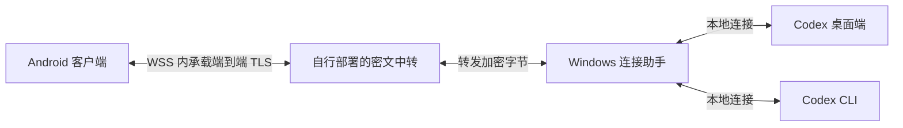

<p align="center">
  
</p>

# Codex Pocket

在 Android 手机上继续电脑中的 Codex 会话。项目由原生 Android 客户端、Windows 连接助手和可自行部署的中转服务组成，保留原生会话 ID、工作目录、模型配置和执行环境。

手机负责阅读和操作，任务仍在自己的电脑上执行。模型 API 凭据留在电脑，中转只转发端到端加密的数据。Codex Pocket 是独立社区项目，与 OpenAI 官方产品没有隶属关系。

**当前源码版本：0.4.0 / Android versionCode 4。** 本仓库提供源码和构建说明，APK、Windows 安装包以及本机配置不纳入 Git。

## 功能

- **会话工作台**：按项目浏览桌面端和 CLI 会话，支持搜索、置顶、重命名、归档与本地草稿。
- **连续对话阅读**：Markdown 正文、代码、图片和紧凑的工具过程；命令、文件修改、推理摘要及子任务可展开查看。
- **原生远控**：续聊、停止、队列、Steer、审批与问题处理。可用操作取决于当前原生运行时公布的能力。
- **紧凑模型控件**：输入区右上方模型胶囊、可搜索模型目录、独立思考强度，以及受支持的 Plan / Fast。
- **项目阅读与审阅**：工作区内只读文件浏览、源码高亮、行号与搜索、Markdown 预览、统一差异和加入草稿的行内评论。
- **玻璃交互**：独立浮动导航和输入区、锚定菜单、浅深主题、按压回弹与状态反馈。
- **配对和恢复**：扫码、相册识码与手动配对，独立的电脑／运行时／会话状态，断线保留缓存和草稿。

## 工作方式



电脑需要保持开机，手机和电脑均需能访问中转。手机通过配对使用电脑现有的原生配置，包括已配置的第三方服务；不需要在手机重复填写模型凭据。中转的 HTTPS 健康检查仅代表服务在运行，实际在线状态还取决于助手心跳和认证连接。

结果未知的写操作会保留待核对状态。先检查原生历史及电脑执行结果，再处理后续请求，应用不会自动重发。

## 开始使用

1. 按下方步骤构建 Android APK 和 Windows 包。
2. 按 [中转部署说明](deploy/README.md) 部署自己的服务，并为首次安装初始化 Windows 私有状态。已有安装升级时保留原状态与签名。
3. 按 [Windows 使用说明](docs/windows-user-guide.md) 校验交付清单，预览并安装连接助手；CLI 接入有单独的安装入口。
4. 在电脑的 **Codex Pocket** 中启用连接，生成配对二维码，在手机中扫描。
5. 等电脑当前任务结束后重新打开已接入的 Codex 桌面或 CLI，手机即可选择对应项目和会话。

如果授权曾被主动撤销，需要生成新二维码重新配对。不要从历史备份恢复已撤销的授权。

## 从源码构建

主要开发环境是 Windows x64。需要 Git、Rust MSVC 工具链、Windows C++ 构建工具、Node.js 22+、JDK 21、Android SDK 36 和 PowerShell 7。Android 最低支持 API 28。Gradle wrapper、Cargo.lock 和 npm lockfile 均已提交。

```powershell
git clone https://github.com/znjhahaha/Codex-Pocket.git
Set-Location Codex-Pocket
```

### Android 开发版

设置 `JAVA_HOME`，并通过 `ANDROID_HOME` 或本地 `android/local.properties` 指定 Android SDK。

```powershell
Set-Location android
.\gradlew.bat :app:assembleDebug --no-daemon
Set-Location ..
```

输出为 `android/app/build/outputs/apk/debug/app-debug.apk`。开发版使用调试签名，与正式版签名不同；覆盖正式安装时应使用原签名构建。

### Windows 与前端

```powershell
cargo build --locked -p pocket-agent -p pocket-bridge
Set-Location desktop
npm ci
npm run build
npm run tauri -- dev
Set-Location ..
```

`desktop` 是独立 Rust workspace。启动开发界面不等于完成助手安装，实际接入按 Windows 使用说明进行。

### 完整签名交付

在 Git 忽略的 `.local/signing/` 下准备自己的 `release.jks` 和 `password.txt`，密钥别名为 `codex-pocket`。脚本读取已有身份，不自动生成或替换签名。后续升级须使用同一把密钥。

```powershell
.\scripts\build-release.ps1 -OutputDirectory .\dist\codex-pocket-0.4.0
.\scripts\windows-verify-release.ps1 -ReleaseDirectory .\dist\codex-pocket-0.4.0
```

输出包括签名 APK、Windows ZIP、Windows 文件目录与 SHA-256 清单。每次选择一个不存在的输出目录，旧交付会保留。源码快照可用 `scripts/package-source.ps1 -OutputDirectory <新目录>` 单独生成。

## 验证

以下命令运行本地测试；真实设备测试需要单独显式启用。不要把真实模型调用作为普通构建检查。

```powershell
cargo test --workspace --locked
node --test scripts/test-bridge.mjs scripts/cli-wrapper-tests.mjs
pwsh -NoProfile -File scripts/windows-installer-tests.ps1
Set-Location desktop
npm ci
npm test
npm run build
Set-Location ../android
.\gradlew.bat :wire:test :app:testDebugUnitTest --no-daemon
.\gradlew.bat :app:lintDebug --no-daemon
Set-Location ..
```

0.4 的既有验收中，MuMu Android 15 在 8 个真实桌面会话间切换 20 次，并停留 120 秒，所有历史读取成功、断线 0 次、模型请求 0 次。该结果不替代真机、CLI、原生生成控制或长期稳定性验证。具体范围见 [当前状态](docs/STATUS.md)。

## 目录

| 目录 | 内容 |
| --- | --- |
| `android/app` | Compose 界面、Room 缓存、草稿、通知与分享 |
| `android/wire` | WSS、端到端 TLS、配对和消息协议 |
| `crates/agent` | Windows 助手、运行时发现、会话与文件访问 |
| `crates/bridge` | Codex 桌面 stdio 桥与双端审批仲裁 |
| `crates/cli-adapter` | 原生 CLI daemon 本地传输 |
| `crates/core`、`crates/tunnel` | 会话归属、命令记录、TLS 与身份存储 |
| `crates/relay`、`deploy` | 密文中转、容器模板与可选推送网关 |
| `desktop` | Tauri 界面、Windows 监督进程与稳定启动器 |
| `scripts` | 构建、可恢复安装和测试脚本 |
| `design` | 自绘图标与品牌资源 |

## 文档与许可

- [Windows 安装、升级与恢复](docs/windows-user-guide.md)
- [中转部署](deploy/README.md)
- [协议与错误处理](docs/WIRE.md)
- [版本状态与验收范围](docs/STATUS.md)
- [第三方许可说明](THIRD_PARTY_NOTICES.md)

项目采用 [MIT License](LICENSE)。本地日志、配对信息、生产服务配置、签名材料和历史任务报告均应保留在 Git 忽略目录中。
